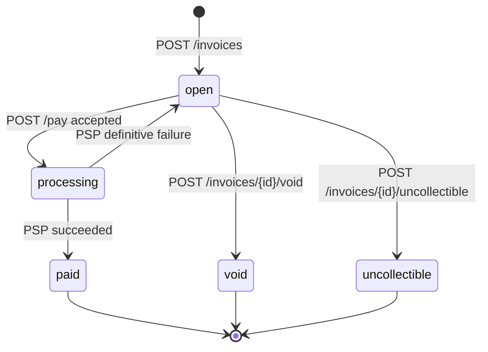
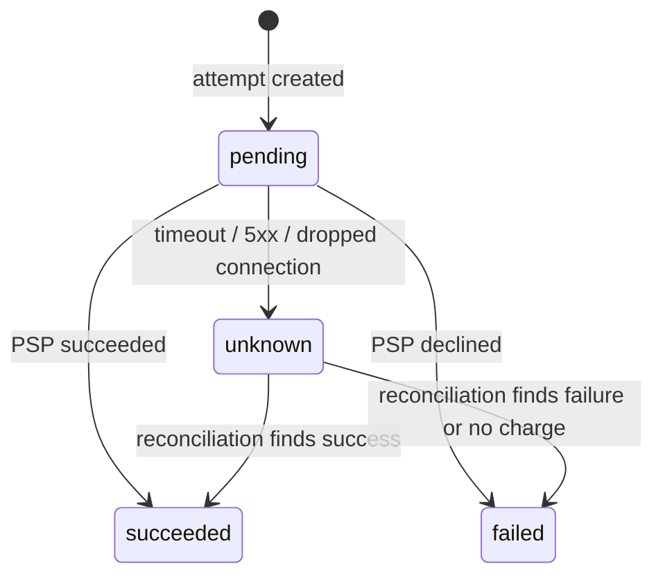

# Paynexa — Design

Rust (Axum, Tokio, SQLx) + PostgreSQL + a mock PSP binary. Money is `BIGINT` cents / `i64` with checked arithmetic; no floats anywhere.

## 1. Data Model

| Table | Key columns | Indexes / constraints |
|---|---|---|
| `businesses` | id, name | PK |
| `api_keys` | business_id, key_prefix, key_hash, revoked_at | unique(key_prefix) |
| `customers` | business_id, name, email | (business_id, created_at desc, id) |
| `invoices` | business_id, customer_id, status, total_cents, currency, due_date | (business_id, status, created_at desc); CHECK status ∈ states, total ≥ 0, currency = 'USD' |
| `invoice_line_items` | invoice_id, description, quantity, unit_amount_cents, line_total_cents | (invoice_id); CHECK quantity > 0, unit ≥ 0 |
| `payment_attempts` | invoice_id, business_id, card_token, status, psp_reference, failure_code | (invoice_id); **partial unique (invoice_id) WHERE status IN ('pending','unknown')**; partial (created_at) WHERE status IN ('pending','unknown') |
| `idempotency_records` | business_id, operation, key, request_hash, payment_attempt_id, response_status, response_body | **unique(business_id, operation, key)** |
| `webhook_endpoints` | business_id, url, signing_secret, active | (business_id) |
| `webhook_events` | endpoint_id, event_type, payload, status, attempt_count, next_attempt_at, last_error | partial (next_attempt_at) WHERE status = 'pending' |

- **Indexes:** tenant-scoped lists and lookups, one in-flight attempt per invoice, unique idempotency keys, API-key lookup by prefix, and small partial scans for the sweeper and webhook dispatcher.
- **Keys and tenancy:** UUID v4 PKs, not enumerable in URLs. Every query filters on `business_id`; cross-tenant IDs return `404`.
- **Why this shape:** invoice (what is owed) and payment attempt (one try to collect) are separate, so a decline fails the attempt, not the invoice, and history is kept. Line items are rows, so the server computes the total; client totals are ignored.
- **At 100x:** partition attempts and events by month, deliver webhooks via a queue, read replicas for lists, expire idempotency records after 24 h.

## 2. Invoice State Machine

Payment attempts:

- **Terminal:** `paid`, `void`, `uncollectible`. Only `processing → open` is reversible, after a *definitive* decline, so another card can be tried.
- **Uncertain ≠ declined:** a timeout or network error makes the attempt `unknown`; the invoice stays `processing` until reconciliation decides. Void is rejected while `processing`, so a late success cannot hit a voided invoice.
- **Enforcement:** every change goes through one `transition(from, to)` table (unit-tested) plus conditional SQL (`WHERE status = $expected`); invalid moves return `409 invalid_state_transition` with `details.current_state`.

## 3. Payment Correctness & Failure Modes

**Flow of `POST /invoices/{id}/pay`:**
1. **Txn 1:** insert idempotency record; `SELECT … FOR UPDATE` the invoice (scoped to `business_id`); require `open`; insert attempt `pending`; set invoice `processing`; **commit**.
2. **PSP call** with no lock held: 2 s connect / 5 s total timeout, `Idempotency-Key = attempt_id`.
3. **Txn 2:** `UPDATE payment_attempts … WHERE status IN ('pending','unknown')`, plus invoice, webhook outbox row and stored response together. 0 rows ⇒ already finalised, no-op.
4. **Sweeper** (every 10 s): attempts `pending`/`unknown` older than 15 s, `FOR UPDATE SKIP LOCKED`; **look up** `GET /charges/{attempt_id}` (never re-charge), apply Txn 2. `404` on an attempt older than 60 s (well past the 5 s client timeout) ⇒ PSP never received it ⇒ attempt `failed`, invoice `open`; younger ⇒ stays `unknown`.

**Mechanism:** row-level lock on the invoice for the short Txn 1, backed by a partial unique index (one in-flight attempt per invoice). Rejected: advisory locks (not tied to the row, leak via pooled connections), serializable isolation (retry loops on every caller), optimistic versioning (same read-check-write, no gain). The lock is never held across the PSP call.

**(a) Concurrent `/pay`.** Different keys: the second blocks on the row lock, then sees `processing` ⇒ `409 payment_in_progress`. Same key: the second blocks on the unique idempotency index, then replays. One attempt, one charge. The losing request's Txn 1 rolls back, including its idempotency record; `409`s are not stored, so that key can be retried later.

**(b) `tok_timeout`.** After 5 s: `202 {attempt_id, status: "unknown"}` (outcome not yet confirmed; don't retry with a new key), attempt `unknown`, invoice `processing`. The PSP finishes in a background task at 30 s; the sweeper sees `succeeded` ⇒ `paid` + `invoice.paid`. Callers poll `GET /payment_attempts/{id}` or wait for the webhook.

**(c) PSP succeeds, we crash before saving.** The attempt was committed before the call, so it survives as `pending`. After restart the sweeper finds `succeeded` and finalises. No second attempt can exist while the invoice is `processing` (a new key gets `409 payment_in_progress`), and the sweeper only looks up, never re-sends; the PSP also dedupes on `attempt_id` as a backstop. No second charge.

**(d) Same key, different body.** `request_hash = sha256(invoice_id ‖ card_token)` mismatch ⇒ `409 idempotency_conflict`, nothing done. Keys are scoped per business and operation.

**(e) `/pay` on `paid`.** `409 invalid_state_transition`, no attempt created. Reusing the original key instead replays the original success.

## 4. Webhook Design

- **Outbox:** event rows (one per active endpoint) are written in the same transaction as the state change, so a committed payment never loses its event.
- **Delivery:** a background dispatcher, off the request path, polls every 1 s with `FOR UPDATE SKIP LOCKED`; 5 s timeout, 2xx = delivered.
- **Signing:** `Paynexa-Signature: t=<unix>,v1=<hex HMAC-SHA256(secret, "<t>.<raw body>")>` plus `Paynexa-Event-Id`; per-endpoint secret shown once. Receivers reject timestamps older than 5 min and dedupe on event ID (at-least-once).
- **Retries:** 0, 1 m, 5 m, 15 m, 1 h, 6 h (6 attempts, ~7.3 h), env-configurable for tests. Then `failed` with `last_error`; businesses reconcile via `GET /webhook_events?status=failed` and `GET /invoices/{id}`.

## 5. API Key Model

- **Format:** `pnx_live_<prefix8>_<32 random bytes, base64url>` from the OS CSPRNG, shown once.
- **Storage:** plaintext prefix for lookup, SHA-256 of the full key compared in constant time. 256-bit keys don't need bcrypt/argon2, which would add per-request latency.
- **Transmission:** `Authorization: Bearer` over TLS terminated at the edge.
- **Revocation/rotation:** `revoked_at` applies on the next request; rotate = create new, deploy, revoke old.
- **Blast radius:** one business's data and payment initiation; no other tenants, no card data. The seeded demo key is labelled `DEV ONLY`.

## 6. What I Cut and Why

1. **Refunds / partial payments:** need a ledger and extra states; the attempt model allows them later.
2. **`draft` state and editing:** nothing edits invoices before issue.
3. **Webhook replay endpoint:** failed events are queryable; replay is later ops tooling.
4. **API key management endpoints:** keys are seeded for now.
5. **Rate limiting:** would be a per-key token bucket at the gateway, stricter on `/pay`.

## 7. Production Readiness Gap

1. **Observability:** metrics on PSP latency/errors, `unknown` attempts and webhook backlog; trace IDs through PSP and webhook logs.
2. **Alerting for stuck money:** `unknown` attempts after 10 min and `failed` webhooks need paging and a manual resolve/replay path; today they are only logged. Residual risk: a request delayed past the 60 s `404` grace could still charge; a real PSP needs a cancel-by-key call.
3. **Audit log:** append-only record of who changed which state, and when.
